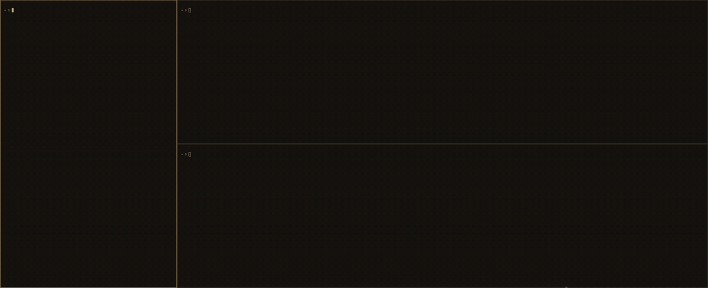
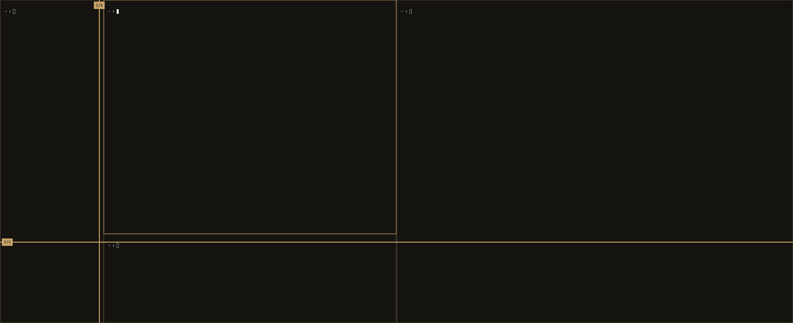

# Omarchy Window Snap

Snap a window to quarters of the screen width and height, eighths of the width on a wide screen, or your own fractions, when you resize it with the mouse in [Omarchy](https://omarchy.org/).



- Drag a window edge (or SUPER + right drag). When the dragged edge comes within 40 pixels of a snap point, a line shows where the edge will land. A corner drag can snap both at once.
- Let go, and the edge snaps there. Only the dragged edge moves, so only the neighbour on that side changes.
- Works with dwindle (any number of windows in a row, stacks and groups included), with the scrolling layout (column width) and with floating windows.

A corner drag shows a line for each axis:



## Known limits

- Scrolling layout: `colresize` decides which side of the column grows, so the other edge may move too. Heights there are untested.
- A nested split such as A | (B / (C | D)), seen from A, puts C and D in the row too; their boundary stays where it is.

## Install

```bash
omarchy plugin add https://github.com/ExeQue/omarchy-window-snap --enable
```

Then load the mouse snapping from `~/.config/hypr/bindings.lua`:

```lua
-- Snap window width and height to fractions of the screen after a mouse resize (exe.snap plugin).
dofile(os.getenv("HOME") .. "/.config/omarchy/plugins/exe.snap/snap-drag.lua")()
```

Hyprland reloads the config on save. Restart the shell once so it picks up the guide line: `omarchy restart shell`.

## Configure

By default the width snaps to quarters, or to eighths on a screen at least 2400 logical pixels wide, and the height to quarters. Pass your own snap points, as fractions or shares of the screen, to the `dofile` line; every option can be left out:

```lua
dofile(os.getenv("HOME") .. "/.config/omarchy/plugins/exe.snap/snap-drag.lua")({
  widths = { "1/3", "1/2", "2/3", 0.4 }, -- default { "1/4", "1/2", "3/4" }
  wide_widths = { "1/4", "1/2", "3/4" }, -- default eighths, "1/8" to "7/8"
  wide = 2400, -- screens at least this wide (logical px) use wide_widths
  heights = { "1/2" }, -- default { "1/4", "1/2", "3/4" }; {} turns height snapping off
  tolerance = 40, -- how close the edge must come, in logical pixels, on both axes
})
```

A fraction shows as itself on the guide line ("1/3"), a share as a percentage ("40%").

## Files

- `snap-drag.lua` watches mouse resizes inside Hyprland and decides when to snap.
- `snap.sh <fraction> <left|right|top|bottom> [address]` moves the dragged edge of that window (default the focused one).
- `Snap.qml` is the shell overlay that draws the guide line.

## Uninstall

Remove the `dofile` line, then `omarchy plugin remove exe.snap`.
