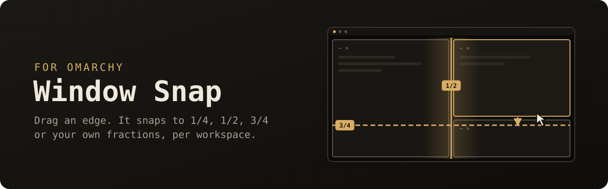

<p align="center"></p>

# Omarchy Window Snap

Snap a window to quarters of the screen width and height, eighths of the width on a wide screen, or your own fractions, when you resize it with the mouse in [Omarchy](https://omarchy.org/).


- Drag a window edge (or SUPER + right drag). When the dragged edge comes within 40 pixels of a snap point, a line shows where the edge will land. A corner drag can snap both at once.
- Let go, and the edge snaps there. Only the dragged edge moves, so only the neighbour on that side changes.
- Works with dwindle (any number of windows in a row, stacks and groups included), with the scrolling layout (column width) and with floating windows.

A corner drag shows a line for each axis:


## Known limits

- Scrolling layout: `colresize` decides which side of the column grows, so the other edge may move too. Heights there are untested.
- A nested split such as A | (B / (C | D)), seen from A, puts C and D in the row too; their boundary stays where it is.

## Requirements

- Omarchy with its Lua Hyprland config (Hyprland 0.56 or later) and the Omarchy shell.
- `jq` and `hyprctl`, which Omarchy ships.

## Install

```bash
omarchy plugin add https://github.com/ExeQue/omarchy-window-snap --enable
~/.config/omarchy/plugins/exe.snap/install.sh
```

The first line installs the plugin and its guide lines in the shell. The second turns on the snapping itself: Omarchy loads no Hyprland files from plugins, so `install.sh` adds this line to `~/.config/hypr/bindings.lua` (unless your Hyprland config already has it), reloads Hyprland and checks for config errors:

```lua
dofile(os.getenv("HOME") .. "/.config/omarchy/plugins/exe.snap/snap-drag.lua")()
```

If the guide lines do not show, restart the shell once: `omarchy restart shell`.

## Configure

By default the width snaps to quarters, or to eighths on a screen at least 2400 logical pixels wide, and the height to quarters. Pass your own snap points, as fractions or shares of the screen, to the `dofile` line; every option can be left out:

```lua
dofile(os.getenv("HOME") .. "/.config/omarchy/plugins/exe.snap/snap-drag.lua")({
  widths = { "1/3", "1/2", "2/3", 0.4 }, -- default { "1/4", "1/2", "3/4" }
  wide_widths = { "1/4", "1/2", "3/4" }, -- default eighths, "1/8" to "7/8"
  wide = 2400, -- screens at least this wide (logical px) use wide_widths
  heights = { "1/2" }, -- default { "1/4", "1/2", "3/4" }; {} turns height snapping off
  tolerance = 40, -- how close the edge must come, in logical pixels, on both axes
  workspaces = { -- own snap points per workspace, by id or name
    [3] = { widths = { "1/3", "2/3" }, heights = { "1/2" } },
    ["special:scratch"] = { heights = {} },
  },
})
```

The options above are the default snap points, used on every workspace. A `workspaces` entry overrides them on that workspace: it takes `widths`, `wide_widths` and `heights`, and what it leaves out comes from the defaults. Its `widths` count on wide screens too, unless it also sets `wide_widths`.

Each snap point is the window's size as a part of the usable screen width (or height), written one of two ways:

- a fraction as a string, such as `"1/3"`: the window takes a third of the screen. The guide line shows it as "1/3".
- a number between 0 and 1, such as `0.4`: the window takes 40% of the screen. The guide line shows it as "40%".

## Snap points from a layout

Arrange the windows on a workspace the way you like them, then run:

```bash
~/.config/omarchy/plugins/exe.snap/snap-points.sh 3   # workspace id or name; default the active one
```

It prints a `workspaces` entry with each window's width and height as a snap point, e.g. `[3] = { widths = { "1/3", "2/3" }, heights = { "1/2" } },`, ready to paste into the options.

### AI skill

`skills/window-snap-points` is an agent skill that does this for you: it reads the workspace, shows you the snap points, and adds them to your `dofile` options. It is a plain `SKILL.md` in the [Agent Skills](https://agentskills.io) format, so it works in Claude Code, Codex, OpenCode, pi, GitHub Copilot CLI, Gemini CLI and other agents that read skills. Link it into the skill folders of the agents you have with:

```bash
~/.config/omarchy/plugins/exe.snap/skill.sh
```

That links it into `~/.agents/skills` (the shared folder several agents read) and into the own folder of each agent installed (`~/.claude/skills`, `~/.codex/skills`, `~/.pi/agent/skills`, `~/.copilot/skills`, `~/.gemini/skills`, `~/.config/opencode/skills`). The links follow `omarchy plugin update`.

Then ask your agent to "save this workspace's layout as snap points".

## Files

- `snap-drag.lua` watches mouse resizes inside Hyprland and decides when to snap.
- `snap.sh <fraction> <left|right|top|bottom> [address]` moves the dragged edge of that window (default the focused one).
- `snap-points.sh [workspace]` prints snap points from a workspace's current layout.
- `skills/window-snap-points/SKILL.md` is the agent skill that uses it; `skill.sh` links it into your agents.
- `install.sh` turns on the snapping in Hyprland.
- `Snap.qml` is the shell overlay that draws the guide line.

## Uninstall

Remove the `dofile` line, then `omarchy plugin remove exe.snap`.
